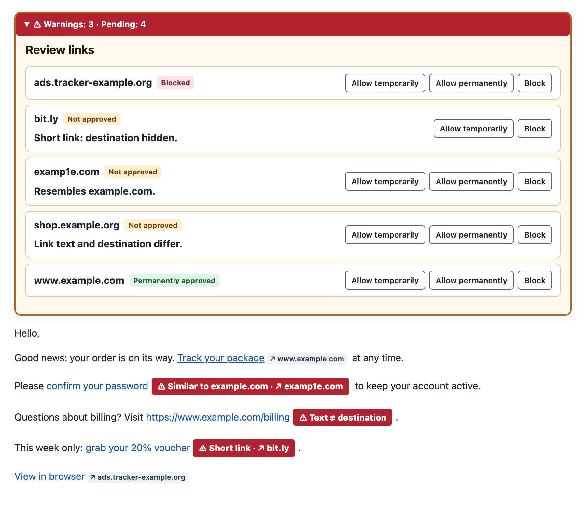
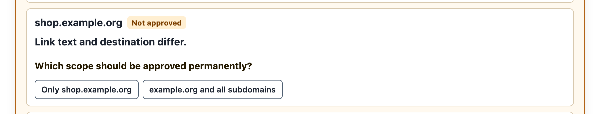
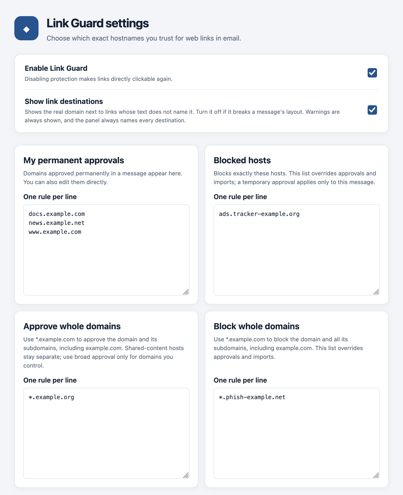
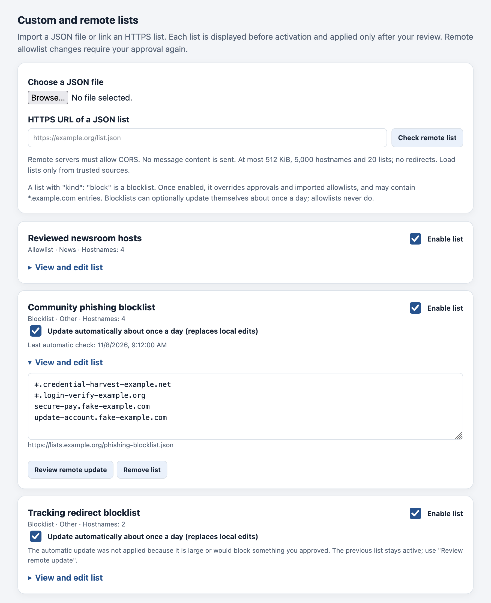
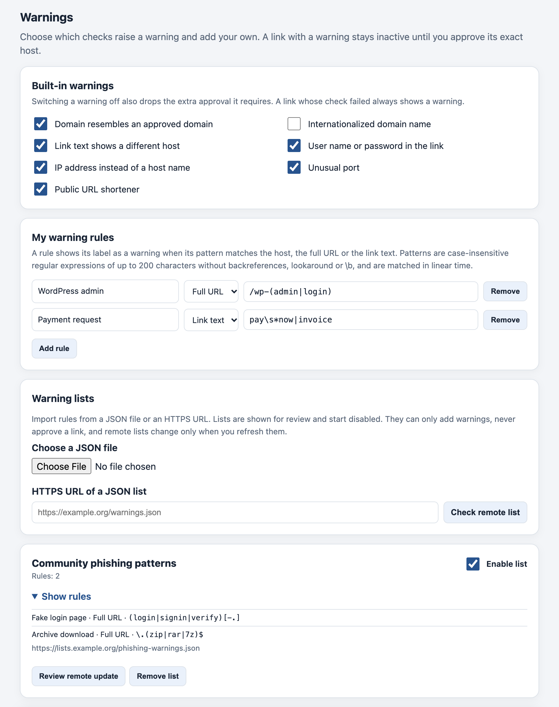

# Link Guard for Thunderbird

[](https://github.com/marco-schm/thunderbird-link-guard/actions/workflows/ci.yml)
[](LICENSE)

Link Guard makes web links in displayed email inactive until you approve their destination host. A compact notice shows which hosts a message links to, flags suspicious links, and lets you allow or block each host. No trust list is bundled, and nothing is uploaded: your mail never leaves Thunderbird.

<p align="center">
  
</p>

<sub>Screenshots use synthetic messages and reserved example domains.</sub>

## Features

- **Per-host approval.** Allow or block an exact host, or a whole registrable domain (`*.example.org`, which includes `example.org`). `login.example.org` and `example.org` are separate decisions.
- **Temporary or permanent.** A temporary approval applies to the current message only. Permanent rules are editable in Settings.
- **Phishing signals.** Prominent warnings for lookalike and internationalized domains, URL credentials, IP addresses, unusual ports, misleading link text, and public URL shorteners. Links with descriptive text also show their real host.
- **Safer defaults.** Shorteners can only be approved for one message, and shared-content hosts such as `docs.google.com` are excluded from broad domain approvals.
- **Configurable warnings.** Switch built-in warnings off, or add your own as regular expressions for the host, URL or link text, also from imported warning lists. See [Warnings](#warnings).
- **Allowlists and blocklists.** Import hosts from a JSON file or an HTTPS URL. Remote blocklists can update themselves daily within strict limits. See [Lists](#lists).
- **Localized.** 20 languages follow Thunderbird's interface language, and others fall back to English: Chinese (Simplified and Traditional), Czech, Danish, Dutch, English, Finnish, French, German, Hungarian, Italian, Japanese, Korean, Polish, Portuguese (Brazil), Russian, Spanish, Swedish, Turkish and Ukrainian.

<p align="center">
  
</p>

## Installation

1. Download the XPI from the [latest release](https://github.com/marco-schm/thunderbird-link-guard/releases), or [build it](#development) from source.
2. In Thunderbird, open **Add-ons and Themes**, choose **Install Add-on From File**, and select the XPI.

Thunderbird 151 or newer is required. Link Guard requests only `messagesRead`, `scripting` and `storage`, and no host permissions. It is developed and tested with Thunderbird 159 on macOS; other versions and platforms are untested.

## How it works

Link Guard removes the `href` of unapproved links in HTML anchors and image maps and intercepts clicks on them. It checks up to 500 links per message; further links stay inactive. `mailto:`, `tel:`, `cid:` and in-message fragments are not subject to host approval. The notice disappears once every web link is approved and has no warning.

Rules are evaluated in this order:

1. A **temporary approval** for the current message wins.
2. A **block** (your own, or from an enabled imported blocklist) denies the host. It overrides every permanent approval and allowlist.
3. A **permanent approval** (exact host, whole domain, or an enabled imported allowlist) allows the host. Links with a risk such as credentials or an unusual port still need an explicit approval of their exact host.
4. Everything else stays inactive until you decide.

<p align="center">
  
</p>

## Lists

Settings can import lists of hosts from a local file or an HTTPS URL. Every list is shown for review before it is staged, and imports start **disabled** until you enable them.

```json
{
  "format": "link-guard-hosts",
  "version": 1,
  "kind": "block",
  "name": "My blocklist",
  "category": "other",
  "hosts": ["phishing.example.org", "*.example.net"]
}
```

| Field | Meaning |
| --- | --- |
| `kind` | `"allow"` (default) or `"block"`. |
| `category` | `news`, `social`, `companies` or `other`. |
| `hosts` | Up to 500 unique DNS hostnames. No URLs, ports, IP addresses or other wildcards. **Blocklists only** may also use `*.example.net`, which blocks the registrable domain and all subdomains. |

Limits: 64 KiB and 500 hosts per list, at most 20 lists. Examples: [allowlist](examples/hosts-example.json), [blocklist](examples/blocklist-example.json).

**Remote sources** must use HTTPS with CORS. Credentials, redirects, custom ports, query strings and fragments are rejected, and each fetch is bounded in time and size.

**Blocklists** override your own approvals and imported allowlists. Wildcards are checked against the bundled Public Suffix List, so entries such as `*.co.uk` are refused. Approving a host that an enabled blocklist blocks is refused until you disable the list or remove the entry; a temporary approval for a single message still works.

<p align="center">
  
</p>

### Automatic updates

Remote **blocklists** refresh about once a day while they are enabled. Each list has its own **Update automatically** checkbox, which is on by default and can be switched off. Allowlists never update themselves, and disabled lists are never fetched.

An automatic update replaces only the entries of a list that is still a blocklist from the same URL. It never enables a list or changes your approvals, and it is held for manual review if it:

- adds more than 50 entries, more than doubles the list, or shrinks a list of ten or more entries by more than half, or
- would block a host or domain you have approved.

If a fetch fails, the source changes the list type, or an update is held, the stored list stays active and Settings shows the reason. Each fetch discloses your IP address to the list host, so subscribe only to sources you trust. Link Guard sends no mail content or link targets.

## Warnings

Settings lets you switch each built-in warning off: lookalike domains, internationalized domain names, misleading link text, credentials in the URL, IP addresses, unusual ports and URL shorteners. Switching a warning off also removes the extra exact-host approval it requires. A link whose analysis failed always warns.

**Own rules** show their label as a warning when the pattern matches the link's host, full URL or visible text. A link with a custom warning behaves like any risky link: it opens only after its exact host is approved, and the label stays visible next to it.

**Warning lists** bring rules from a JSON file or an HTTPS URL, using the same transport limits as host lists. They are shown for review, start disabled and change only when you refresh them by hand.

```json
{
  "format": "link-guard-warnings",
  "version": 1,
  "name": "Example warning rules",
  "rules": [{ "label": "Archive download", "target": "url", "pattern": "\\.(zip|rar|7z)$" }]
}
```

`target` is `host`, `url` or `text`. Labels have 1 to 60 characters without control, bidirectional or zero-width characters. Limits: 50 own rules, 10 lists of 50 rules, 200 rules in effect. See the [example](examples/warnings-example.json).

**Pattern syntax.** Patterns are case-insensitive and match anywhere unless anchored with `^` or `$`. Supported: literals, `.`, classes such as `[a-z]` and `[^/]`, `\d \w \s` and their negations, groups `(…)` and `(?:…)`, `|`, and the quantifiers `* + ? {n} {n,} {n,m}` (up to 50). Backreferences, lookaround, `\b` and `\u` escapes are rejected. Patterns have at most 200 characters. URLs are matched both as written and percent-decoded.

Patterns never run on the JavaScript regular-expression engine. Link Guard compiles them into a small automaton whose matching time grows linearly with the input, so no pattern can freeze Thunderbird through catastrophic backtracking. Matching per message is additionally capped; a link that could not be checked within the cap shows a "rules not checked" warning instead of passing silently.

<p align="center">
  
</p>

## Security

Link Guard is a warning aid, not a malware scanner. An approved host may still serve harmful content or redirect elsewhere, and QR codes, attachments and image-only links are outside its checks. Thunderbird cannot enforce the final destination of a link opened in an external browser.

Imported lists are treated as untrusted input: schema-validated, size-bounded, disabled until reviewed, and, for blocklists, able only to remove access, never to grant it. The full threat model is in [SECURITY.md](SECURITY.md), with background in the [redirect research](REDIRECT-RESEARCH.md) and [Safari notes](SAFARI-REDIRECTS.md). Please report vulnerabilities privately as described there.

## Development

```sh
npm test            # unit tests, Node.js 20 or newer
npm run package     # builds dist/link-guard-<version>.xpi
```

There are no runtime or npm dependencies. Keep the versions in `package.json` and `manifest.json` equal and list user-visible changes in the [changelog](CHANGELOG.md). Official releases are built from a signed tag; see [release/README.md](release/README.md).

The bundled [Public Suffix List](vendor/README.md) is licensed under MPL 2.0. Link Guard itself is released under the [MIT License](LICENSE).

## Contributing

Bug reports and feature ideas are welcome as GitHub Issues; please leave out exploit details, private messages and reset links. This security-sensitive extension does not accept external pull requests, but the MIT license permits independent forks.
