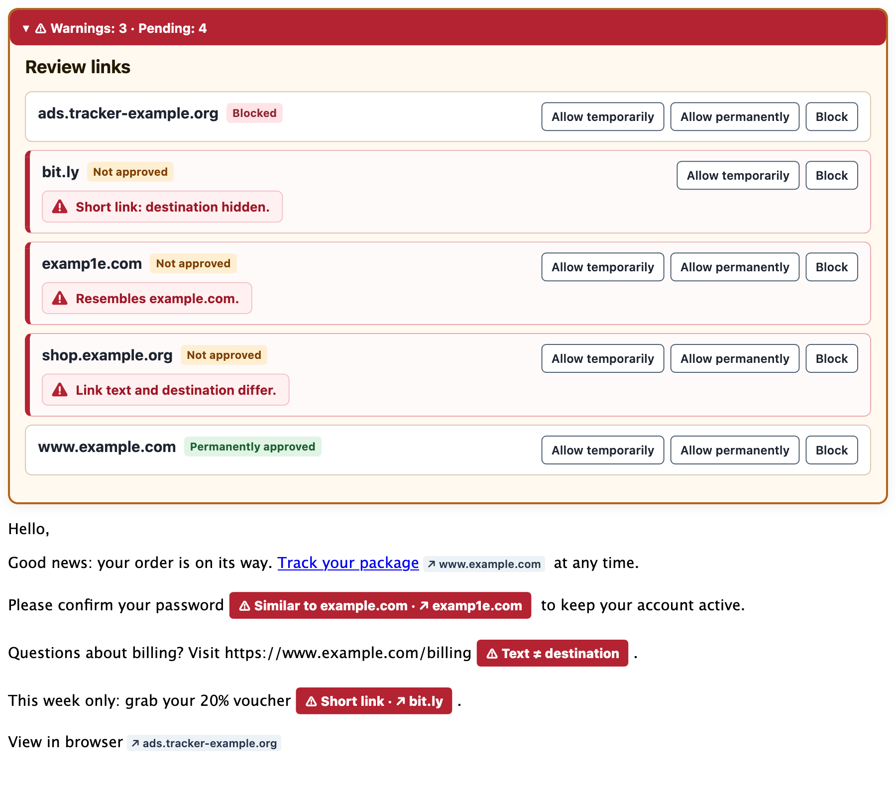

# Link Guard for Thunderbird

Link Guard is a Thunderbird add-on that keeps web links in email inactive until you
approve where they lead. Every displayed message gets a compact notice that lists the
destination hosts, flags suspicious links, and lets you allow or block each host for
this message only or permanently.

Nothing leaves your computer: Link Guard checks messages locally, ships no trust list
and sends no mail content or link targets anywhere.

## What it does

- **Holds every web link until you decide.** A link becomes clickable only after its
  destination host is approved, either for the current message or permanently.
- **Shows where a link really goes.** Links whose text does not name their destination
  show the real host next to them, and the notice lists every destination in the
  message.
- **Warns about phishing patterns.** Lookalike and internationalized domains,
  misleading link text, credentials in the URL, IP addresses, public URL shorteners,
  script code in the link and redirects to sites you have not approved get prominent
  warnings and need a deliberate approval of the exact host.
- **Lets you decide at the right scope.** Approve or block one exact host
  (`login.example.org`) or a whole registrable domain with all its subdomains
  (`*.example.org`).
- **Supports lists and your own rules.** Import allowlists and blocklists from files or
  HTTPS sources, and add warning rules as regular expressions.

## What it is not

Link Guard is a warning aid. It does not scan files or websites for malware, it does not
check who sent a message, and it cannot see where a link redirects after you open it in
your browser. An approved host can still serve harmful content. See
[Security model](security.md) for the exact boundaries.

## Documentation

| Page | Read it when you want to … |
| --- | --- |
| [Getting started](getting-started.md) | install Link Guard and handle your first message |
| [Using Link Guard](using-link-guard.md) | understand the notice, link labels and toolbar button |
| [Approvals and blocks](approvals-and-blocks.md) | know which decision wins and what a scope covers |
| [Warnings](warnings.md) | understand each warning and when it appears |
| [Settings](settings.md) | find every option on the Settings page |
| [Host lists](lists.md) | import, write or host allowlists and blocklists |
| [Warning rules](warning-rules.md) | write your own rules or warning lists |
| [Security model](security.md) | know what Link Guard protects against and what it does not |
| [Privacy](privacy.md) | see what is stored and what is ever sent over the network |
| [FAQ](faq.md) | get quick answers to common questions |
| [Troubleshooting](troubleshooting.md) | fix links that do not behave as expected |
| [Development](development.md) | build, test, translate or release Link Guard |

## At a glance

| | |
| --- | --- |
| Thunderbird | 151 or newer; developed and tested with Thunderbird 159 on macOS |
| Permissions | `messagesRead`, `scripting`, `storage`; no host permissions |
| Languages | 20, following Thunderbird's interface language; others fall back to English |
| Network access | none, except list sources you add yourself |
| License | MIT; the bundled Public Suffix List is MPL 2.0 |
| Source | [github.com/marco-schm/thunderbird-link-guard](https://github.com/marco-schm/thunderbird-link-guard) |

This documentation follows the `main` branch of the repository. The
[changelog](https://github.com/marco-schm/thunderbird-link-guard/blob/main/CHANGELOG.md)
lists which release introduced each change.
