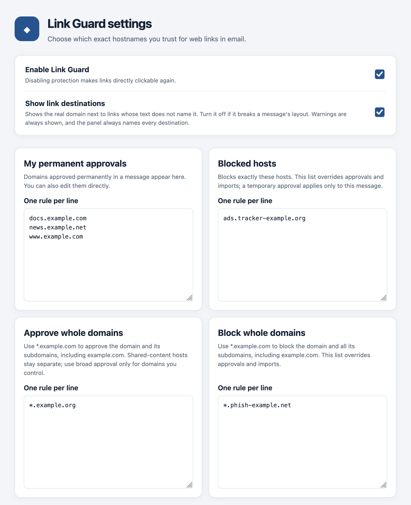
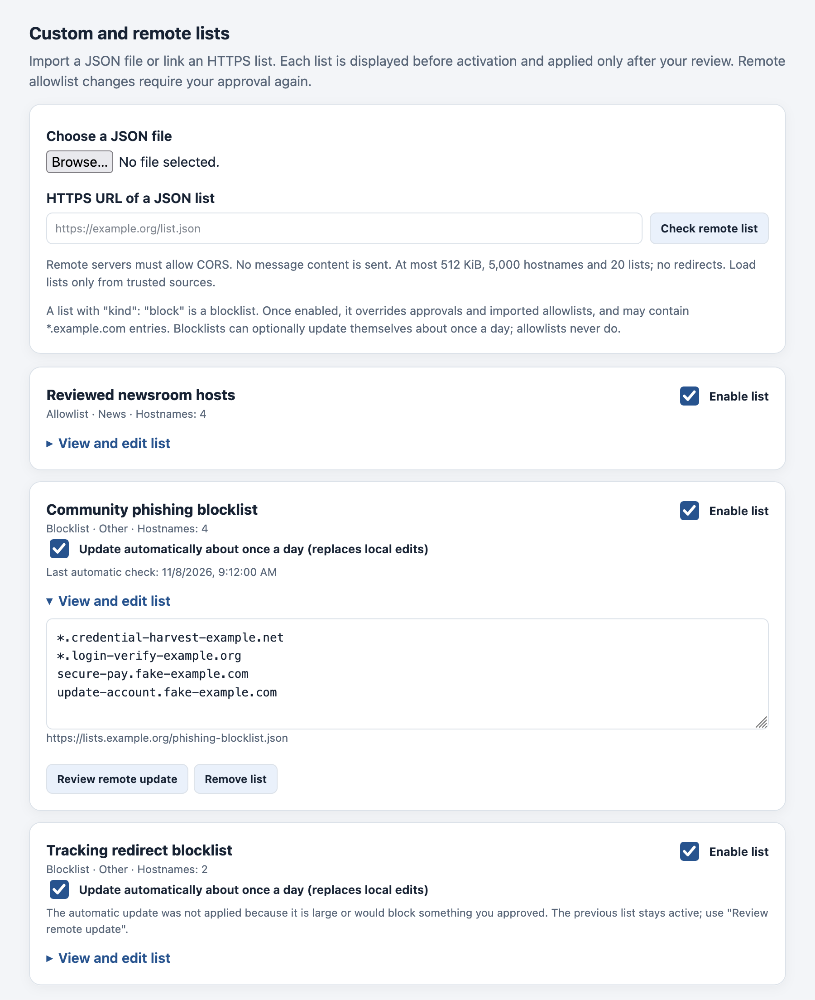
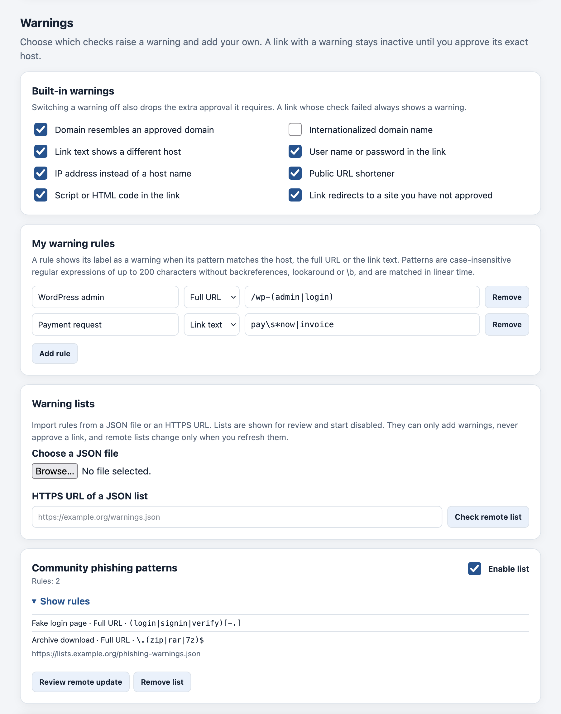

# Settings

Open Settings with the **Link Guard** button in the message header toolbar, the
**Link Guard – open settings** button in the main toolbar, or from **Add-ons and
Themes** → Link Guard → **Options**.

Changes take effect only after you click **Save changes** at the bottom of the page.
Open messages update immediately after saving.

## General

### Enable Link Guard

Turns the protection on or off. When it is off, all links are directly clickable again,
no notice or labels are shown, and the toolbar tooltip reads *Link Guard is disabled*.
Your approvals, blocks and lists are kept. On by default.

### Show link destinations

Shows the real domain next to links whose text does not name it, for example
**↗ shop.example.org** after a button labelled *Order now*. Turn it off if these labels
disturb the layout of your messages. On by default.

This setting only hides the neutral destination labels. Warning labels, including the
destination they name, are always shown, and the notice always lists every destination.

## Your rules

Four cards hold your own permanent decisions. Each takes one rule per line, up to 500
per card. Decisions you make in a message appear here, and you can also edit the lists
directly.

| Card | Format | Effect |
| --- | --- | --- |
| **My permanent approvals** | exact hosts, e.g. `login.example.org` | allows exactly these hosts |
| **Blocked hosts** | exact hosts | blocks exactly these hosts; overrides approvals and imports |
| **Approve whole domains** | `*.example.org` | allows the domain and all subdomains, except shared-content hosts |
| **Block whole domains** | `*.example.org` | blocks the domain and all subdomains; overrides approvals and imports |

Rules for writing hosts:

- Exact hosts have no wildcard. `login.example.org` and `example.org` are different hosts.
- Whole-domain rules use `*.example.org` and include `example.org` itself. The domain
  must be a registrable domain according to the bundled Public Suffix List, so `*.co.uk`
  or `*.github.io` are refused with a message naming the entry.
- No URLs, paths, ports, user names or IP addresses. Upper case and a trailing dot are
  normalised; internationalized names are stored in their `xn--` form.
- An invalid line is reported with its line number, and nothing is saved until it is
  fixed.

See [Approvals and blocks](approvals-and-blocks.md) for how these rules combine.

## Custom and remote lists

Import allowlists and blocklists from a JSON file or an HTTPS URL. The format and the
requirements for remote sources are described in [Host lists](lists.md).

### Importing a list

1. Choose a JSON file, or enter the HTTPS URL of a list and click **Check remote list**.
2. Link Guard validates the list and shows a **Preview** with its name, type, category
   and every entry.
3. Click **Stage as disabled list** to add it, or **Cancel**.
4. Tick **Enable list** when you have reviewed it, then click **Save changes**.

Lists always start disabled. A disabled list has no effect.

### Managing a list

Each imported list is a card showing its name, type (**Allowlist** or **Blocklist**),
category and number of entries.

- **Enable list** – turns the list on or off.
- **View and edit list** – shows the entries; you can edit them directly. Blocklists may
  contain `*.example.org` entries, allowlists only exact hosts.
- **Review remote update** – for lists loaded from a URL: fetches the current version
  and shows it as a preview. **Stage update** replaces the entries and leaves the list
  **disabled** until you enable it again.
- **Update automatically about once a day (replaces local edits)** – for remote
  **blocklists** only; on by default. See [Automatic updates](lists.md#automatic-updates).
- **Remove list** – removes the list on the next save.

Up to 20 lists, each with up to 500 entries.

## Warnings

### Built-in warnings

One switch per built-in warning, all on by default:

- Domain resembles an approved domain
- Internationalized domain name
- Link text shows a different host
- User name or password in the link
- IP address instead of a host name
- Unusual port
- Public URL shortener

Switching a warning off removes both the warning and the exact approval it requires.
*Domain check unavailable* cannot be switched off. See [Warnings](warnings.md).

### My warning rules

Click **Add rule** to add a row with:

- **Label** – the text shown as the warning, 1 to 60 characters.
- **Checks** – what the pattern is matched against: **Host**, **Full URL** or **Link
  text**.
- **Pattern** – a case-insensitive regular expression of up to 200 characters.

**Remove** deletes a row. Up to 50 rules of your own. Errors are reported with the rule
number when you save, for example *Rule 2: the pattern is longer than 200 characters.*
The supported syntax is described in [Warning rules](warning-rules.md#pattern-syntax).

### Warning lists

Import rules from a JSON file or an HTTPS URL. As with host lists, a **Warning list
preview** shows every rule; **Stage as disabled list** adds it disabled, and **Enable
list** turns it on. **Show rules** lists the rules of an imported list. Remote warning
lists change only when you click **Review remote update** – they never update
themselves.

Up to 10 warning lists of up to 50 rules each, and at most 200 rules in effect in total.

## Saving

**Save changes** validates everything on the page and stores it in one step. If
something is invalid, a message near the button names the card and line or rule, and
nothing is stored.

If your lists changed elsewhere while the page was open – for example because you
approved a host in a message – the page says *Lists changed elsewhere. Reload this page
before saving.* Reload the page and repeat your edits; this prevents one change from
overwriting the other.
