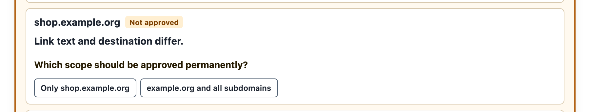

# Using Link Guard

This page explains everything Link Guard shows in a message: the notice at the top,
the labels next to links, and the toolbar button.

## The notice

When a message contains web links that are not approved, or links with a warning,
Link Guard shows a notice at the very top of the message.

**Collapsed**, it is a single line:

- **Links pending: 3** – three links are inactive and waiting for your decision.
- **⚠ Warnings: 1 · Pending: 3** (red) – at least one link has a warning.

**Click it to expand.** The expanded notice, titled **Review links**, has one row per
destination host, sorted alphabetically. Each row shows:

1. the **host name** exactly as the link resolves to it,
2. its **status** (see below),
3. any **warnings** for that host, each in a red box with a red warning triangle,
4. the **actions** you can take.

Rows of hosts with a warning have a red edge, so they stand out when you scan the list.
The notice disappears as soon as every web link in the message is approved and none of
them has a warning.

### Statuses

| Status | Meaning |
| --- | --- |
| **Not approved** | No decision yet, or the host needs an exact approval because of a warning. Its links are inactive. |
| **For this message** | You allowed the host temporarily. Its links work until you show another message. |
| **Permanently approved** | The exact host is in your approvals or in an enabled allowlist. |
| **Approved via whole domain** | The host belongs to a domain you approved with all subdomains. |
| **Blocked** | The host is blocked by your rules or by an enabled blocklist. Its links stay inactive. |

### Actions

| Action | What happens |
| --- | --- |
| **Allow temporarily** | The host's links work in this message only. The approval ends when you show another message. |
| **Allow permanently** | Asks for the scope, then remembers the approval in [Settings](settings.md). |
| **Block** | Asks for the scope, then keeps the host's links inactive in every message. |

When you choose **Allow permanently** or **Block**, Link Guard asks for the scope:

- **Only `login.example.org`** – exactly this host. `example.org` and other subdomains
  are separate decisions.
- **`example.org` and all subdomains** – the whole registrable domain, including
  `example.org` itself. This option appears only when the domain can be determined
  reliably from the bundled Public Suffix List.

Some actions are deliberately limited:

- **Shared-content hosts** such as `docs.google.com` or `github.io` sites, where anyone
  can publish, can only be approved exactly. The notice says *Others can publish content
  here. Approve only this host.* See [Approvals and blocks](approvals-and-blocks.md#shared-content-hosts).
- **Public URL shorteners** such as `bit.ly` hide their destination. They can only be
  allowed for the current message, after a second, red confirmation: *This short link
  hides its destination. Allow it for this message?*
- **Links to an IP address** can only be allowed for the current message.

### Links that cannot be approved

Some links are never opened, whatever you decide. They are listed under **Links that
cannot be approved** with the reason and the number of such links:

- **Link target is invalid or too long** – the address cannot be parsed or is longer
  than 8,192 characters.
- **Link uses an unsupported protocol** – for example `javascript:`, `data:` or `file:`.

### Messages with many links

Link Guard checks the first 500 links of a message. If a message has more, the notice
says *More than 500 links: Additional links remain blocked and are not listed here.*
Those additional links stay inactive.

### Error messages

- *Approvals could not be loaded. Web links remain blocked.* – Link Guard could not
  read your settings. Links stay inactive until it can.
- *Decision could not be saved. The link remains blocked.* – A permanent decision was
  refused, usually because an enabled blocklist or one of your whole-domain blocks
  covers the host. See [Troubleshooting](troubleshooting.md).

## Labels next to links

Link Guard places small labels directly after links in the message text.

- **Red warning labels** appear after links with a warning, for example
  **⚠ Text ≠ destination**, **⚠ Similar to example.org**, **⚠ Short link** or
  **⚠ IP address**. They stay visible even after you approve the host.
- **Grey destination labels** such as **↗ shop.example.org** appear after links whose
  text does not show their destination, for example a button labelled *Order now*. If
  such a label disturbs a message's layout, you can switch it off with **Show link
  destinations** in [Settings](settings.md#show-link-destinations). Warning labels and the
  notice are not affected by that setting.

A message cannot hide, shrink, fade or rewrite these labels with its own styles.
Links in image maps, SVG graphics and mathematical formulas get no label; they are
listed in the notice like every other link.

## Clicking a link

- An **approved** link opens as usual, in your default browser.
- An **inactive** link does nothing. Instead, the notice expands and scrolls into view
  so you can decide.
- Middle-clicks and other mouse buttons are handled the same way.

## The toolbar button

Link Guard adds a **Link Guard** button to the message header toolbar.

- Its **badge** shows the number of inactive links (up to 99), or **!** when a link has
  a warning or the message has more than 500 links.
- The badge is **red** when a link is blocked or has a warning, and **orange** when links
  are only waiting for a decision.
- Its **tooltip** summarises the message, for example *Link Guard: 3 blocked links* or
  *Link Guard: no blocked web links*.
- **Clicking it opens Settings.**

The button is drawn by Thunderbird, outside the message, so a message cannot cover or
change it. It is a useful second signal if a message looks unusual.

A second button in the main toolbar, **Link Guard – open settings**, also opens
Settings.

## Which links are covered

Link Guard handles every element that Thunderbird itself opens as a web link:

- ordinary links (`<a href>`), including those in plain-text messages,
- image maps (`<area>`),
- links in SVG graphics, including the legacy `xlink:href` form,
- links in mathematical formulas (MathML elements with an `href`),
- links inside shadow trees, open or closed.

HTML `<link>` elements, which a message could style into a clickable box, are hidden.

Each destination is taken as Thunderbird resolves it. A `<base href>` in the message is
honoured, so a link written as `#top` or with an empty target is treated as a web link
when the base points to the web.

Not subject to approval, and therefore left alone:

- `mailto:` and `tel:` links,
- `cid:` references to parts of the message,
- jumps to anchors within the message itself.

## Turning Link Guard off

Switch off **Enable Link Guard** in [Settings](settings.md) to make all links directly
clickable again. The notice and labels disappear and the toolbar tooltip reads *Link
Guard is disabled*. Your approvals, blocks and lists are kept.
